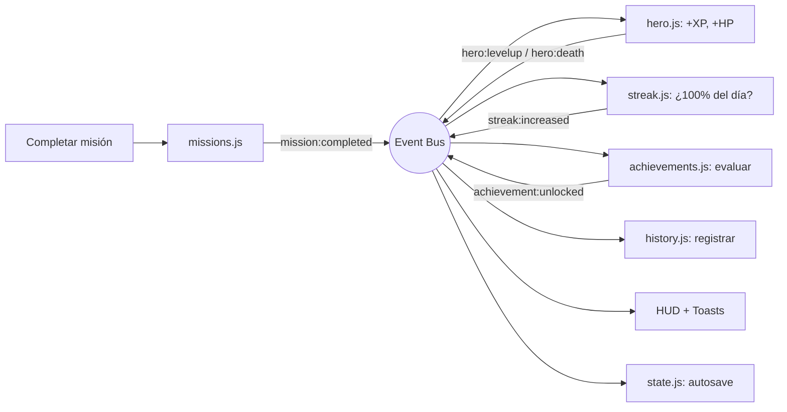
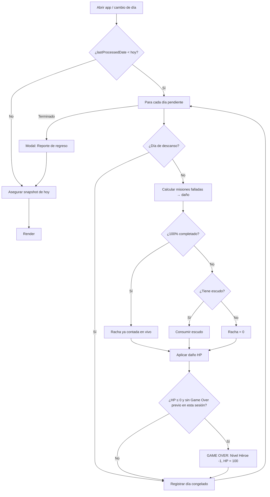

# gamelife.dev v3.0 — Plan de Implementación

Plan para añadir **HP, Racha, Logros/Títulos, Save State e Historial** a gamelife.dev, manteniendo el estilo pixel-art, los 6 temas y el stack actual (HTML + CSS + JS vanilla, sin servidor).

---

## 1. Diagnóstico del estado actual

| Área | Estado actual | Problema para las nuevas features |
|---|---|---|
| Persistencia | ~12 claves sueltas en `localStorage` (`rpg_stats`, `rpg_missions`, `profile_*`, `custom_background_*`…) | No hay un "estado de partida" unificado → imposible hacer Save/Export fiable |
| Misiones | Solo guardan `lastCompleted` (último día) | No hay historial diario → imposible calcular daño, racha o gráficas |
| Fechas | `getTodayString()` devuelve `2026-10-5` (sin ceros) | No ordenable; frágil para cálculos de días |
| Progreso | Solo niveles por atributo | No existe un "nivel general" que se pueda perder |
| Código | `main.js` monolítico de 648 líneas | Crecerá a ~2000 líneas; difícil de mantener |
| Toasts | Un solo toast, se sobrescriben entre sí | Logros + level up + daño simultáneos se pisarían |

---

## 2. Decisiones de diseño (confirmadas)

### 2.1 Nivel de Héroe (nuevo)
- Track global independiente: **toda XP ganada en misiones alimenta también al héroe** (1:1).
- Curva: `xpParaSiguiente(nivel) = 100 + (nivel - 1) × 50` → Nv.10 ≈ 3 semanas, Nv.50 ≈ 2 años de constancia.
- **Migración**: el nivel de héroe inicial se calcula con la XP que ya tienes acumulada en tus atributos (no empiezas de cero).
- Rangos automáticos según nivel: `Novato (1-4) → Aprendiz (5-9) → Aventurero (10-19) → Veterano (20-34) → Héroe (35-49) → Leyenda (50+)`.

### 2.2 Sistema de HP
- **HP máx: 100**.
- **Daño** por misión no completada al cerrar el día: `Nv1 = 5 · Nv2 = 8 · Nv3 = 12 · Nv4 = 15`.
- **Curación**: al completar una misión `+1/+2/+3/+4 HP` (según nivel) y **+10 HP bonus** por completar el 100% del día.
- **HP = 0 → GAME OVER**: pierdes 1 Nivel de Héroe (la XP del nivel actual se reinicia a 0), el HP se restaura al 100% y queda registrado en el historial. Tus niveles de atributo **no** se tocan.
- 🛡️ **Regla anti-frustración**: máximo **1 Game Over por sesión de regreso** (si vuelves tras 2 semanas, no pierdes 4 niveles de golpe).
- 🔒 **Anti-exploit**: al empezar cada día se toma una "foto" de las misiones activas. Borrar una misión no completada **no** evita el daño de ese día.

### 2.3 Racha + Escudos
- Un día cuenta como **cumplido** si completas el **100%** de sus misiones (días sin misiones = neutros, no rompen ni suman).
- La racha sube **en tiempo real** en el momento en que completas la última misión del día (con animación 🔥).
- **Escudos de Racha**: +1 cada 7 días consecutivos (máx. 2). Si fallas un día y tienes escudo, se consume automáticamente y la racha se conserva.
- Se guarda `rachaActual`, `mejorRacha` y escudos.

### 2.4 Días ausentes + Modo Descanso
- Al abrir la app, el **Motor de Días** procesa todos los días pendientes desde la última visita. Días sin abrir la app = todas las misiones falladas.
- **Modo Descanso**: el usuario reserva de 1 a 3 días **a partir de mañana** (máx. 3 días por mes calendario). Esos días congelan HP y racha. Se programa a futuro para evitar el truco de "activarlo a las 23:59 tras fallar".
- Detección de **cambio de día en vivo** (si la app queda abierta pasada la medianoche).

### 2.5 Save State
- **Autoguardado** continuo (debounce de 500 ms tras cualquier cambio).
- **Botón SAVE** en la barra superior (+ atajo `Ctrl+S`): crea un **punto de guardado** con fecha, hora y resumen (Nivel, HP, racha) que puedes **restaurar** después.
- **Exportar / Importar `.json`**: backup completo (progreso + perfil + temas + fondos + audio), con checksum para detectar archivos corruptos o editados, y migración automática de versiones.
- Las imágenes (avatar/fondos) se **comprimen** (máx. 512 px avatar / 1920 px fondo, WebP) antes de guardar para no superar el límite de ~5 MB de `localStorage`.

---

## 3. Arquitectura

### 3.1 Estado unificado (`gamelife_save`, schema v3)

```js
GameState = {
  schemaVersion: 3,
  meta:     { createdAt, lastProcessedDate, lastSavedAt, appVersion },
  profile:  { name, bio, avatar, equippedTitle },
  settings: { theme, backgrounds: { [theme]: url }, sound, volume, bgmTrack },
  stats:    { fuerza: { current, max, level }, ... },          // existente
  missions: [{ id, name, stat, level, createdAt, lastCompleted }],
  cooldowns:{ 2: date, 3: date, 4: date },                       // existente
  hero:     { level, xp, totalXpEarned, hp, maxHp, deaths },
  streak:   { current, best, shields, lastCountedDate },
  rest:     { days: ['2026-10-12', ...], usedByMonth: { '2026-10': 2 } },
  dailyLog: { '2026-10-05': { scheduled: [{id, level, stat}], completed: [id],
                              xp, hpDelta, perfect, rest } },
  counters: { missionsTotal, perStat: {...}, perLevel: {...}, perfectDays, ... },
  achievements: { [id]: { unlockedAt } },
  history:  [{ ts, type, data }]                                 // máx. 500 eventos
}
```

### 3.2 Estructura de archivos

Se usarán **scripts clásicos** (no ES Modules) porque: (a) los módulos ES no funcionan abriendo `index.html` con doble clic (`file://` bloquea por CORS), y (b) los `onclick=""` del HTML necesitan funciones globales.

```
gamelife/
├── index.html            (nuevos modales, HUD, botones de nav)
├── style.css             (estilos base existentes)
├── css/
│   └── systems.css       (HUD, HP, racha, medallas, crónica, game over)
└── js/
    ├── core/
    │   ├── utils.js        fechas ISO, diff de días, debounce, hash
    │   ├── bus.js          event bus (emit/on) para desacoplar sistemas
    │   └── state.js        GameState, migración legacy, autosave
    ├── audio.js            (extraído tal cual de main.js + nuevos SFX)
    ├── ui/
    │   ├── toasts.js       cola de notificaciones
    │   ├── modals.js
    │   ├── hud.js          HP, Nivel Héroe, racha, título
    │   └── chronicle.js    modal de logros / historial / gráficas
    ├── systems/
    │   ├── profile.js      (extraído) perfil, avatar, temas, fondos
    │   ├── missions.js     (extraído + dailyLog + snapshot)
    │   ├── hero.js         nivel de héroe + HP + game over
    │   ├── streak.js       racha + escudos
    │   ├── rest.js         modo descanso
    │   ├── day-engine.js   procesamiento de días / rollover
    │   ├── achievements.js catálogo + motor de evaluación
    │   ├── titles.js       títulos dinámicos
    │   ├── history.js      registro de eventos
    │   └── save.js         save points, export/import
    └── main.js             bootstrap (orden de inicialización)
```

### 3.3 Flujo de eventos



### 3.4 Motor de Días (al abrir la app y a medianoche)



---

## 4. Logros, Medallas y Títulos

Catálogo **data-driven** (fácil añadir más): cada logro define `id, nombre, descripción, icono pixel, tier, categoría, condición(state), recompensa`.

**Tiers de medalla**: 🥉 Bronce · 🥈 Plata · 🥇 Oro · 💎 Legendario (con brillo animado).

| Categoría | Logros (ejemplos) |
|---|---|
| 🔥 Constancia | Racha de 3, 7, 14, 30, 60, 100, 365 días |
| ⚔️ Misiones totales | 1, 10, 50, 100, 250, 500, 1000 completadas |
| 💪 Por atributo | 25 / 100 misiones de Fuerza ("Titán"), Sabiduría ("Erudito"), Creatividad ("Artista"), Carisma ("Diplomático") |
| ⭐ Nivel de Héroe | Nivel 5, 10, 25, 50 |
| ✨ Días perfectos | 1, 10, 50, 100 días al 100% |
| 🐉 Épicas | 10 / 50 misiones de Nivel 4 |
| ⚖️ Balance | Todos los atributos ≥ Nv.5 / ≥ Nv.10 |
| 🕵️ Secretos | **Fénix** (racha de 7 tras un Game Over), **Madrugador** (misión antes de 7:00), **Búho Nocturno** (misión después de 23:00), **Escudo de Hierro** (salvar racha con escudo), **Inmortal** (30 días sin bajar de 50 HP) |

~35 logros en total. Los secretos aparecen como `???` hasta desbloquearse.

**Títulos dinámicos**:
- **Automático** por rango de Nivel de Héroe (Novato → Leyenda).
- **Desbloqueables** con logros: *"El Imparable"* (racha 30), *"Fénix"*, *"Maestro Equilibrado"*, *"Leyenda Viviente"*, etc.
- El usuario **equipa** su título favorito; reemplaza el texto fijo actual "Héroe Activo" bajo el nombre.

---

## 5. Cambios por archivo

### [MODIFY] [index.html](file:///c:/Users/LENOVO/Desktop/vs%20code%20web%20projects/gamelife/index.html)
- **Nav**: nuevos botones `[SAVE]` (con indicador "Guardado hace 2 min"), `[LOGROS]` y versión `v3.0.0`.
- **Panel de perfil**: HUD con barra de HP segmentada, Nivel de Héroe + barra XP, contador de racha 🔥 + escudos, título equipado.
- **Nuevos modales**:
  - `chronicle-modal` — "CRÓNICAS DEL HÉROE" con pestañas: **Medallas · Títulos · Crónica (línea de tiempo) · Progreso** (heatmap tipo GitHub de 12 semanas, gráfica de XP de 30 días, resumen: misiones totales, mejor racha, Game Overs, días activos).
  - `save-modal` — "GESTIÓN DE PARTIDA": Guardar ahora, Restaurar punto de guardado, Exportar, Importar, Nueva partida.
  - `gameover-modal` — pantalla dramática con "CONTINUE?".
  - `report-modal` — reporte al regresar (días procesados, daño, racha).
  - `rest-modal` — programar Modo Descanso.
- Reemplazar `<script src="main.js">` por los nuevos scripts en orden.

### [NEW] `css/systems.css`
- Nuevos tokens por tema: `--hp-color`, `--hp-low`, `--streak-color`, `--tier-bronze/silver/gold/legendary`.
- Animaciones: números flotantes de daño/curación, pulso de HP bajo (<25%), llama de racha, brillo de medallas, screen-shake + flash rojo en Game Over.
- Responsive móvil para todos los modales nuevos.

### [DELETE → SPLIT] [main.js](file:///c:/Users/LENOVO/Desktop/vs%20code%20web%20projects/gamelife/main.js)
- Se reparte entre `js/audio.js`, `js/systems/profile.js`, `js/systems/missions.js`, `js/ui/*`. Toda la lógica existente (cooldowns, límites de 2 misiones por atributo, drag & drop, Ctrl+V, música) se **preserva intacta**.

### [MODIFY] [style.css](file:///c:/Users/LENOVO/Desktop/vs%20code%20web%20projects/gamelife/style.css)
- Ajustes menores (nav con más botones, toasts apilables).

---

## 6. Fases de ejecución

| Fase | Contenido | Resultado verificable |
|---|---|---|
| **0. Cimientos** | Split de `main.js`, event bus, `GameState` v3, migración de datos legacy (con backup), fechas ISO | La app se ve y funciona **exactamente igual**, sin perder datos |
| **1. Héroe + HP** | Nivel de héroe, HP, curación, Motor de Días, Game Over, reporte de regreso | HUD visible, daño aplicado al simular días |
| **2. Racha** | Racha en vivo, escudos, Modo Descanso | Racha sube al 100%, escudos se consumen |
| **3. Logros + Títulos** | Catálogo, motor, toasts en cola, títulos equipables | Logros se desbloquean con fanfarria |
| **4. Historial** | Crónica, heatmap, gráfica XP, resumen | Modal con 4 pestañas funcional |
| **5. Save State** | Save points, Ctrl+S, export/import con checksum, compresión de imágenes | Exportar → borrar → importar restaura todo |
| **6. Pulido** | Sonidos nuevos (daño, game over, logro), responsive, prueba en los 6 temas | QA completo |

---

## 7. Plan de verificación

- **Modo debug** `index.html?debug=1`: panel oculto con "⏩ Avanzar 1 día", "💀 Dañar 50 HP", "🔥 +7 racha", "🧹 Reset". Imprescindible para probar sistemas basados en tiempo sin esperar días reales.
- **Pruebas en navegador** (subagente) de los escenarios:
  1. Migración: datos v2 existentes → v3 sin pérdidas.
  2. Completar todas las misiones → racha +1, +10 HP bonus.
  3. Saltar 1 día sin completar → daño correcto, escudo consumido / racha rota.
  4. Saltar 10 días → máximo 1 Game Over, reporte correcto.
  5. Modo descanso → HP y racha congelados.
  6. Desbloqueo de logros + equipar título.
  7. Exportar `.json` → borrar datos → importar → estado idéntico.
  8. Revisión visual en los 6 temas + móvil.

---

## 8. Preguntas abiertas

> [!IMPORTANT]
> **Bonus de XP por racha (propuesta extra)**: ¿quieres que la racha otorgue multiplicador de XP? Ej.: racha 3+ → ×1.1, 7+ → ×1.2, 30+ → ×1.5. Aumenta mucho la retención (patrón Duolingo), pero acelera la progresión.

> [!NOTE]
> **Deshacer misión**: hoy no se puede desmarcar una misión completada por error. ¿Añadimos "deshacer" (solo el mismo día)? Recomiendo **sí**, ya que ahora una misión afecta HP, racha y logros.

> [!WARNING]
> El historial diario empieza a registrarse **desde la v3**. Los días anteriores no existen en tus datos actuales, por lo que las gráficas y el contador de misiones totales arrancarán desde la actualización (el Nivel de Héroe sí se calcula con tu XP previa).

---

## 9. Expansión V4: Behavioral Design (Economía y Retención)

Para convertir la app en un hábito inquebrantable, la fase V4 incorpora mecánicas de retención psicológicas inspiradas en juegos móviles de éxito:

1. **Economía de Oro y Tienda (Recompensas Tangibles)**:
   - **Moneda**: Las misiones dan XP y 🪙 Oro (ej. +10 Oro por misión, bonus de +50 por día perfecto).
   - **Tienda (Shop)**: Nuevo modal `shop-modal` donde gastar Oro.
   - **Cero Escapatorias (Ética de Juego)**: *NO se puede comprar salud (HP) ni escudos con Oro*. Los errores de la vida real se asumen y se pagan. 
   - **Cosméticos y Coleccionables**: El Oro se gasta en cosas que no alteran tu disciplina: Temas visuales premium, marcos de avatar, o una "Mascota Virtual" pixel art.
   - **Recompensas Custom Restringidas**: Puedes configurar recompensas reales (ej. "Tarde libre" = 500 Oro), pero el sistema bloquea su compra si tu HP está por debajo del 50% (no hay recompensas si estás fallando).

2. **Drops Aleatorios y Críticos (Recompensas Variables)**:
   - Al marcar una misión, hay un ~15% de probabilidad de "Éxito Crítico", otorgando doble Oro o un escudo gratis.
   - Genera el efecto "tragamonedas" (dopamina impredecible), rompiendo la previsibilidad aburrida de ganar siempre 10 XP.

3. **Batallas contra Jefes Semanales (Mecánicas de Tensión)**:
   - Cada fin de semana (o día 7 de racha), aparece un "Jefe" en el HUD.
   - Se le derrota haciendo el 100% de las misiones ese día. Si fallas, el Jefe "ataca" haciendo daño multiplicativo a tu HP.
   - Vencerlo da Oro Masivo, EXP y títulos exclusivos.

4. **El Purgatorio (Manejo Positivo del Game Over)**:
   - En lugar de simplemente perder niveles secamente, llegar a 0 HP te inflige una "Maldición".
   - Tu avatar se ve en escala de grises, y ganas 50% menos de recursos. 
   - Para romper la maldición (Redención), debes cumplir 3 días perfectos seguidos. Transforma el fracaso en un nuevo reto motivador.
