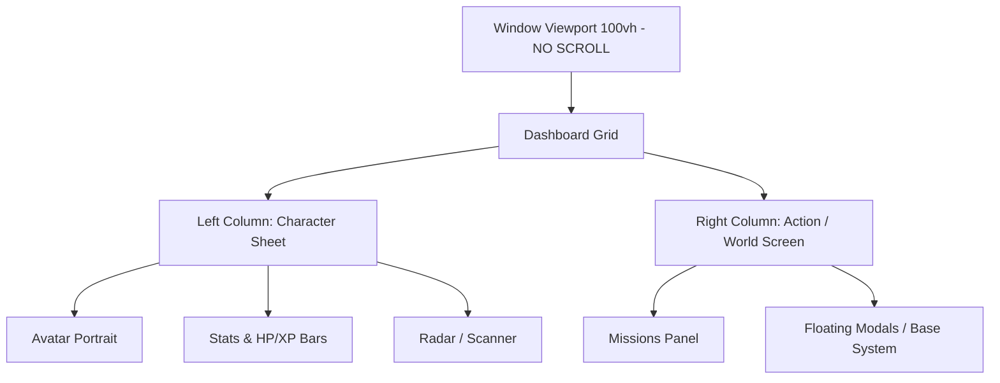
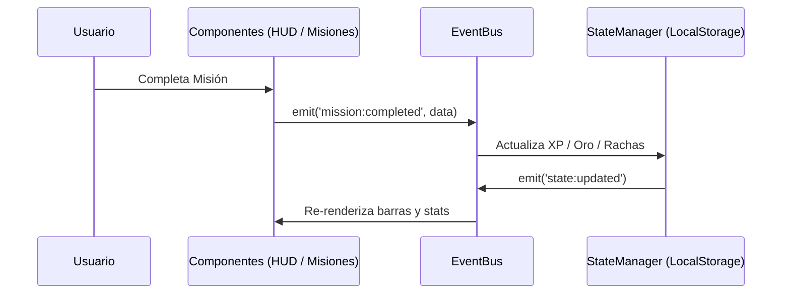
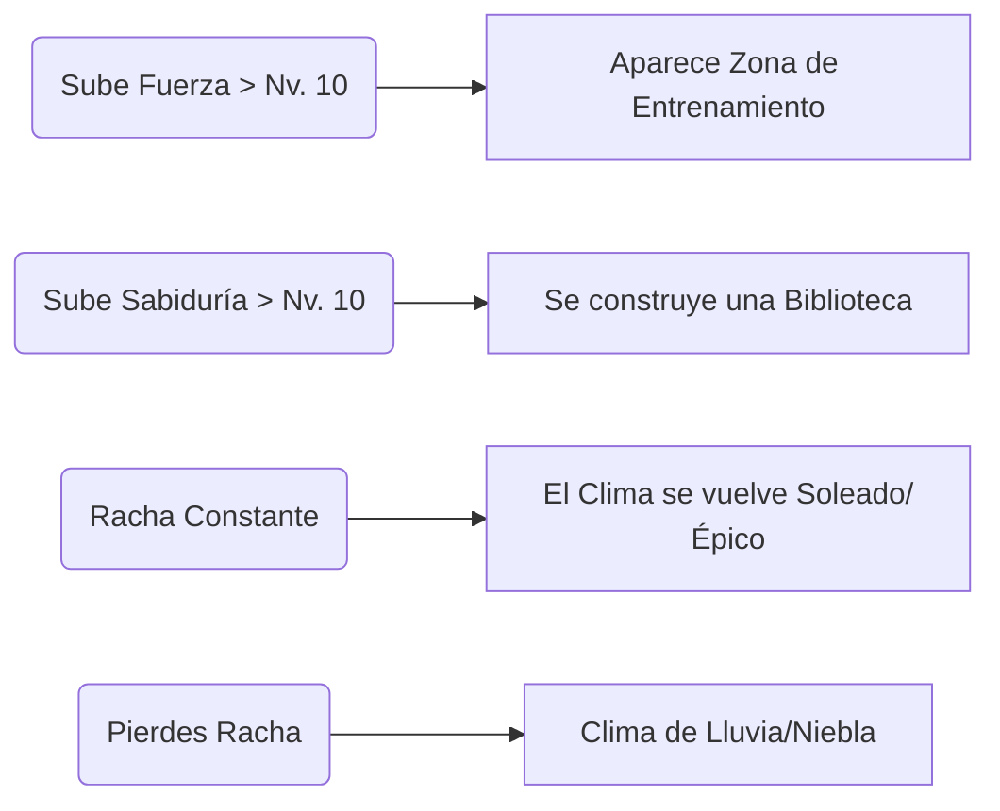

# GameLife - Master Architecture Document (V4)

Este documento es el manifiesto central y blueprint técnico de GameLife. Detalla los cambios estructurales mayores, la arquitectura de estado, el nuevo paradigma de interfaz y la estructura del Ecosistema de la Base.

---

## 1. Arquitectura de Interfaz de Usuario (UI/UX)
El mayor cambio de paradigma en V4 fue la erradicación del "Web Dashboard Layout" (scroll global, banners web) por un **JRPG Fixed Layout** (Engine UI).

### Diagrama de Layout Estructural

### Reglas de Diseño de Interfaz:
- **Zero-Scroll Global:** El `body` tiene `overflow: hidden`. Solo los contenedores internos tienen barras de desplazamiento (*customizadas en CSS con bordes duros*).
- **Tipografía Dual:**
  - `Pixelify Sans`: Usado para nombres, diálogos y descripciones. Ofrece legibilidad sin sangrado visual.
  - `Press Start 2P`: Restringido exclusivamente a números (Niveles, Oro, XP), estadísticas y botones de acción.
- **Bordes Puntiagudos:** Eliminación absoluta de `border-radius`. Todo elemento usa bordes duros con múltiples capas de `box-shadow: inset` para generar profundidad de 8-bits.

---

## 2. Arquitectura de Estado y Lógica (Core)
El juego no se basa en manipular el DOM directamente; usa una arquitectura reactiva mediante un bus de eventos.

### Diagrama de Flujo de Estado

- Todas las lógicas de las Misiones, Tienda y Perfil deben emitir eventos a través del `EventBus` para mantener la separación de responsabilidades (SOLID).

---

## 3. El Ecosistema de la Base (V4)
La Base deja de ser una compra lineal de edificios estáticos y se transforma en un **mapa de calor interactivo de tu vida real**.

### Pilares Mecánicos de la Base

#### A. Santuario Dinámico (Crecimiento de Atributos)
La base crece hacia donde crece tu personaje.

#### B. Trofeos Permanentes y Mobiliario
- **Mobiliario (Comprable con Oro):** El usuario diseña su propio espacio usando el oro de sus recompensas (sillas, estandartes, cofres).
- **Reliquias Inamovibles (Hitos):** Completar objetivos mayores (ej. 30 días seguidos, Jefe derrotado) inyecta artefactos legendarios (ej. Estatua Dorada) directamente en la base que no se pueden comprar.

#### C. Compañero Espiritual (Pet System)
Un NPC vinculado a tus acciones diarias.
- Cada día que completas tu meta diaria, el Espíritu gana EXP.
- Al acumular suficiente EXP, evoluciona visualmente (Chispa -> Lobo -> Dragón).
- Si tu HP llega a 0 o rompes rachas mayores, el espíritu se marchita, añadiendo responsabilidad emocional.

---

## Próximos Pasos de Implementación Tecnológica
1. **Migración Gráfica de la Base:** Pasar de `` fijos en `base.js` a un `HTML5 Canvas` o a un `CSS Grid` absoluto donde cada mueble/trofeo tenga coordenadas (x,y).
2. **Sistema de Clima:** Añadir una capa transparente con animaciones CSS (lluvia de pixeles o rayos de luz) condicionada por el estado de `StateManager.data.streaks.current`.
3. **Rediseño del Modal:** Convertir el modal de la Base en una vista en pantalla completa dentro de la `Columna Derecha` (Action Screen) para maximizar el espacio de diseño interactivo.
